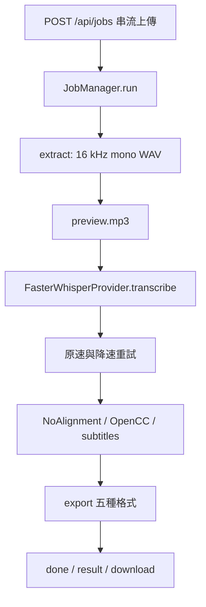
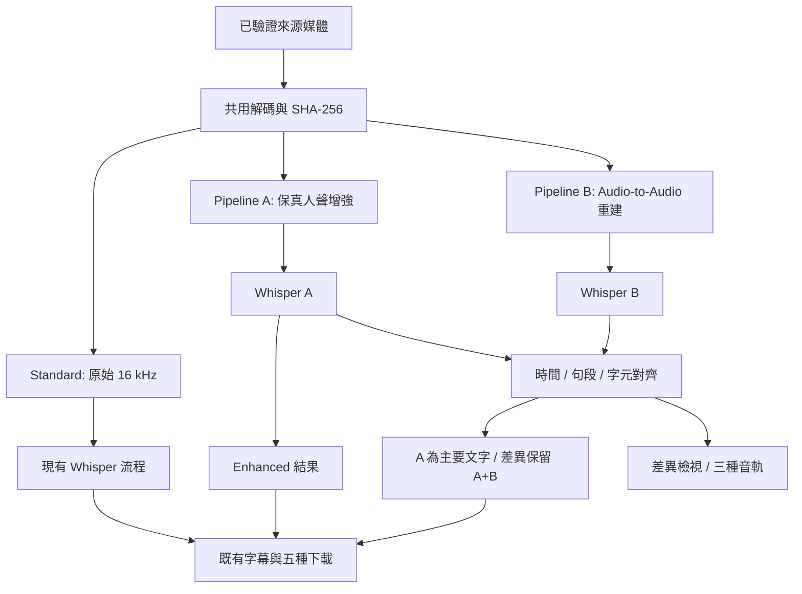

# 雙軌語音辨識：第一階段架構分析

日期：2026-09-19。狀態：**架構提案完成，等待人工 Review；功能實作與模型部署待核准。**

本文件依據本機原始碼、套件鎖定檔、實際 GPU 查詢及下列官方來源編寫。模型描述是文獻調查，效能預算是設計目標；本次完成文件與唯讀檢查，尚未下載候選模型、執行候選推論或建立真實 CER／WER 成績。

## 1. 建議決策與驗收原則

1. 保留既有 Standard 行為與五種下載格式；新模式採用獨立模組、明確版本與可回退的工作流程。
2. Pipeline A 首輪評估 **ClearVoice／FRCRN_SE_16K**，因其 16 kHz 輸入可銜接現有解碼；以 **DeepFilterNet3** 作為 48 kHz 保真降噪對照。最終選擇依中文 CER／WER，而非聽感排名。
3. Pipeline B 首輪評估 **Resemble Enhance** 的音訊重建，VoiceFixer 作為備選。B 僅提供第二份候選，A 是預設最終文字來源。
4. 先驗證循序執行；通過硬體實測與記憶體預算後，再啟用預處理並行。A／B Whisper 共用一個模型實例、序列辨識。
5. 文字相同標為 MATCH；重要差異保留 A、B 與原音，標為需要確認。A／B 來自同一原音與同一 Whisper，屬於相關證據；一致性並非正確率或統計獨立驗證。
6. 第一版自動 Final 維持 A。單靠差異標記，Final 的 CER 理論上與 A 相同；B 的價值先以錯誤提示召回率與人工修正效益衡量。自動提升到超過 A，需要另外驗證的選擇規則。

### 人工 Review 決策單

| 決策 | 建議 | 理由／待確認 |
|---|---|---|
| A 首選與對照 | FRCRN_SE_16K；DeepFilterNet3 對照 | 降低現有 16 kHz 系統整合成本，保留模型競賽 |
| B 定位 | 實驗性 Audio→Audio 重建 | 中文、聲線、韻律與時間對齊仍需實測 |
| B 架構符合度 | 接受生成式修復作為候選；保留嚴格特徵解耦方案為研究項 | Resemble Enhance 不是已證實具備獨立 Content／Speaker／Prosody 三個 encoder 的完整實作；若三者都是硬性要求，B 保持待研究 |
| 硬體 | 先支援本機 3060／12 GB，3090／24 GB 為另一驗收環境 | 本機實測與需求指定不同 |
| 快取 | 跨工作／重啟快取，預設 7 天、20 GiB，可清除或停用 | 這會延長原本只保留當次工作的音訊與逐字稿生命週期 |
| 人聲範圍 | 保留來源中的所有可辨識說話者 | 人群中的其他說話者可能也是有效內容；特定講者擷取需另外定義目標 |
| 啟用門檻 | 通過 benchmark 後才將進階模式標為可用 | 語音清晰度與辨識正確率分開驗收 |
| 開發環境 | 核准後建立 Git 基準與獨立 staging | 目前沒有可沿用的 Git／staging 配置 |

## 2. Current Architecture：實際現況

檢查範圍：`app/{config,audio,transcriber,jobs,main,subtitle,cleanup}.py`、`static/app.js`、`templates/index.html`、啟動／安裝檔、`tests/`、`requirements-lock.txt`、`.venv/pyvenv.cfg` 與 `VERIFICATION.md`。

| 項目 | 已確認現況 |
|---|---|
| 平台 | Windows；Python 3.12.10 虛擬環境 |
| 服務／前端 | FastAPI 0.116.1、Uvicorn 0.35.0；原生 HTML／CSS／JavaScript |
| Whisper | faster-whisper 1.2.1、CTranslate2 4.8.2、Systran faster-whisper-large-v3 |
| GPU | `nvidia-smi` 回報 NVIDIA GeForce RTX 3060、12288 MiB、驅動 581.29；3090 未在本機驗證 |
| 運算設定 | CUDA float16；特定 CUDA／記憶體錯誤後重做 CPU int8 |
| PyTorch | 目前鎖定檔無 torch／torchaudio，本機 site-packages 也未發現對應目錄；Whisper 由 CTranslate2 執行 |
| CUDA 函式庫 | 鎖定 nvidia-cublas-cu12 12.9.1.4、nvidia-cudnn-cu12 9.10.2.21；載入時加入 DLL 路徑 |
| 解碼 | FFmpeg：優先 PATH，否則 imageio-ffmpeg 0.6.0；第一音軌 → 單聲道 16 kHz PCM16 WAV |
| 格式／上限 | mp4/mov/mkv/avi/mp3/wav/m4a/aac/flac/webm；上傳上限 30 GiB |
| 分段 | WAV 串流讀取，每段最多 300 秒；末端十秒內可找安靜點切割 |
| Whisper 參數 | beam_size=5、word_timestamps=True、vad_filter=True、condition_on_previous_text=True；其餘多用套件預設 |
| 自動語言 | 第一個有 VAD 語音的區塊決定後續語言 |
| 排程 | ThreadPoolExecutor(max_workers=1)，單次一工作；忙碌時拒絕下一次上傳，沒有持久佇列 |
| 狀態 | 記憶體 jobs 字典；頁面約每 1.5 秒輪詢；降速階段目前不顯示可量測百分比 |
| 字幕 | NoAlignment 原樣返回；依 Whisper 字詞時間分字幕，OpenCC s2twp 作顯示轉換 |
| 匯出 | TXT、帶時間碼 TXT、SRT、VTT、JSON 全部寫好後才標 done |
| 暫存／清除 | `WORK=DATA/temp/session-<uuid>`；新工作清除上一工作；關閉服務清除 session；模型另存 `DATA/models` |
| Git／Staging | `git rev-parse --show-toplevel` 回報非 Git 儲存庫；未發現 staging 配置 |

目前 `outputs/` 根目錄不是運行中結果的可靠位置；真正輸出位於 session 下。唯讀查詢應以 `/api/jobs` 與該工作輸出為準。

### 2.1 現有資料流與插入點



最佳插入點是 `JobManager.run` 的原音解碼完成後、現有 `provider.transcribe` 前；最終選擇器位於辨識完成後、`subtitles/export` 前。Standard 保留現有分支。預覽音訊的建立可與模式調度分離，避免預覽編码異常阻止可用逐字稿交付。

### 2.2 必須納入回歸基準的既有風險

- `_stretch` 使用 NumPy 插值拉長 1.5 倍；相同取樣率播放會降低音高，約 -7 半音，並非保音高 time-stretch。把此策略標為 legacy recovery，另測 FFmpeg atempo 等保音高方案。
- 目前重試取得非空文字即替換；以 RMS 判斷有聲，可能把音樂當成語音。新增實驗應保留原速與重試候選，記錄來源和評分。
- `_uncovered_audible_windows` 以一秒格檢查；格內只要有片段交集即視為覆盖，較短漏字仍可能漏檢。測試包含局部缺字、長停頓與背景音。
- `_number` 會修剪／丟棄重疊 segment，但未同步重建 word 時間；新的正規化契約需驗證 word 包含於 segment，保留重疊原始證據。
- faster-whisper 的 Segment 有 `avg_logprob`、`no_speech_prob`、`temperature`；目前 wrapper 沒有保存。新增欄位可直接擷取；不可取得的 token probability 使用 null。
- `snapshot_download` 未固定 revision。實驗需記錄／固定模型 revision 與權重 checksum，使快取與 benchmark 可重現。
- 既有 `VERIFICATION.md` 記錄合成語音驗證，無真實宴會廳 ground truth；過去的程式測試通過不能代表 CER 改善。
- `pythonw` 的標準輸出可能為空；新增背景子程序須驗證 Uvicorn 日誌輸出、FFmpeg／GPU 探測與清理程序皆無視窗。將啟動失敗寫到可讀日誌，保留當次下載；與模型改動分開驗收。

## 3. Proposed Architecture 與 Data Flow



圖表示資料相依；實際 GPU 排程預設循序。

| 模式 | 音訊／辨識 | 結果來源 |
|---|---|---|
| Standard | 原音 → 現有 Whisper＋legacy recovery | 現有結果；模式缺省仍為 standard |
| Enhanced | 原音 → A → Whisper A | A；失敗轉 Standard |
| Dual Track | 原音分別進 A、B → 兩次相同配置 Whisper → 比較 | A＋review 標記；B 異常轉 Enhanced |

A 與 B 都從原始 master 分支。模型內建的 denoiser 可以是 B 的一部分；B 不接收 A 逐字稿或以 A 文本重新配音，避免把首次錯字重新生成成「佐證」。

### 3.1 音訊與 Provider 契約

- `AudioArtifact`：artifact_id、相對路徑、sample_rate、channels、sample_count、source_duration、source_hash、processing_steps、time_map、model_revision、checksum。
- `AudioProcessor.process(source, destination, config, progress) -> AudioArtifact`；另提供 capabilities、validate、release。A／B 採可替換 adapter。
- `TranscriptionResult`：raw segments、raw words、language、language_probability、device、compute_type、decode_config、recovery_candidates、model_revision。
- `ComparisonResult`：alignment groups、字元 edit operations、風險種類、review status、來源 segment IDs；`FinalResult` 保留相容的頂層 segments/subtitles。
- 模型只接收可信本機 WAV 或陣列；沿用現有媒體格式／protocol 白名單、上傳大小與路徑保護。固定模型 registry 控制下載與啟動命令。

### 3.2 解碼、取樣率與長音訊

Standard 保持目前 16 kHz 路徑。進階模式建立最多 48 kHz 的共用 float32 master，保留來源聲道資訊；由 master 派生 16／44.1／48 kHz 輸入。來源只有 16 kHz 時如實記錄頻寬；升採樣不等同恢復原始高頻。

每份來源只解碼一次。模型推論使用有界區塊、前後 context 與 overlap-add，起始設計為約 20 秒核心區段、各 1 秒 context，依 adapter 的限制調整；例如 HTDemucs 依其 7.8 秒限制配置。拼接以原始 sample index 為唯一座標，保留靜音。長 WAV 採 RF64／分塊 manifest 或 lossless FLAC，覆蓋超過 RIFF 4 GiB 的情況。

48 kHz mono float32 約 0.69 GB／小時，16 kHz PCM16 約 0.115 GB／小時，雙聲道 master 加倍；多軌、預覽、cache 寫入另計。建立中間檔前估算空間、串流處理並回收可重建中間檔。

## 4. Pipeline A：保真增強

候選預設鏈：原始 master → 保真 enhancer（FRCRN 或 DeepFilterNet3）→ 視錄音情境啟用的背景音樂分離／dereverb → 固定增益 loudness normalization → 16 kHz `enhanced_speech.wav` → Whisper A。

需求中的 enhancement、separation、NR、dereverb 是能力要求；一個模型可以涵蓋多項。以 ablation 驗證有用的步驟與順序，避免固定串接數個重複降噪器。背景音樂 preset 可比較先分離再降噪的順序，版本完整記錄。

FRCRN 是降噪候選，不能據此宣稱已完整解決混響。強混響設立獨立測試門檻；dereverb adapter 通過門檻後才啟用。Demucs 用於音樂伴奏情境，保留 vocals stem 並驗證說話字音完整性；多人對話維持全講者內容，特定講者擷取另需使用者定義目標。必要 EQ／compressor 各有獨立 preset，預設先以最少處理驗證。

Normalization 初始候選為約 -23 LUFS、true peak 上限 -1 dBTP，屬待測設定；短語音／純靜音保持原增益或保守 peak 處理，完整記錄 gain 與 clipping 比例。

## 5. Pipeline B：重建能力與需求落差

Resemble Enhance 官方提供 denoiser 及生成式 enhancer，訓練包含 autoencoder、vocoder 和 latent conditional flow matching，符合 Audio→Audio 修復方向；官方 HF 模型卡標示 English。它是本次 B 的優先實驗候選，**中文 phoneme、聲線、prosody、逐字時間保持仍屬未驗證**。[官方說明](https://github.com/resemble-ai/resemble-enhance)、[模型卡](https://huggingface.co/ResembleAI/resemble-enhance)

嚴格的「Speech Separation → Content Encoder＋Speaker Encoder＋Prosody Encoder → Reconstruction」尚無本次查核即可認定完整符合全部需求的即用方案。B adapter 記錄能力矩陣：音訊重建、顯式三特徵、中文實測、時間保持、原說話者保持，各自標示 verified／unsupported／unverified。若採用 Resemble，應在 Review 明確接受此架構差異。

VoiceFixer 為分析／神經 vocoder 修復備選。Seed-VC 可研究 content encoder、聲線條件與 vocoder，但其主要用途是聲線轉換，與保留原聲的目的有落差；採研究候選而非預設 B。其官方倉庫目前 archived、GPL-3.0，且部分模型以 Whisper 為 content encoder，會進一步增加與辨識器的相關性。[VoiceFixer](https://github.com/haoheliu/voicefixer)、[Seed-VC](https://github.com/Plachtaa/seed-vc)

B 產出 `reconstructed_speech.wav`，同時保存來源區段與模型參數。只從本次原音取得聲音資訊，原音永遠可播放作裁決依據。重建低信心或空白時，把候選標示不可用，交由 A 完成輸出。

### 5.1 時間軸驗證

1. 用樣本數與取樣率驗證總時長，以固定 overlap-add 邊界重建原時間軸。
2. 測量／補償模型固定 delay，對每段保存 `source_start`, `source_end`, `output_start`, `output_end`。
3. 以來源與輸出的能量 onset／聲學特徵單調對齊，檢查片內漂移。相同檔案長度只保證外形，不能證明字音時間一致。
4. 初始驗收目標：校正後邊界誤差 ≤20 ms、人工語音錨點 p95 ≤100 ms；屬 Review 後以資料校準的門檻。
5. 只有已通過的時間映射用於 Whisper B→原音換算；漂移超限或無法對齊時 B 標記 `alignment_unreliable`，保留 A 時碼並顯示需要確認。
6. 保存 raw timestamps 與 mapped timestamps，禁止以整檔線性縮放掩蓋局部停頓變動；維持每個 word 在對應 segment 範圍內。

## 6. Model Candidates／Model Comparison

以下授權欄分開列程式碼與模型權重。商用整合須保留相應 LICENSE／NOTICE，且在實作時固定實際 artifact revision；表列官方標示不是所有衍生權重的通用授權。

| 候選 | 能力／角色 | 程式碼／權重授權查核 | 中文／保真證據 | GPU、速度與 VRAM | 整合判定 |
|---|---|---|---|---|---|
| FRCRN_SE_16K / ClearVoice | 16 kHz speech denoising；A 首輪 | code Apache-2.0；官方 HF 權重亦標 Apache-2.0 [S1] | 可輸入中文音訊；官方此卡未提供本場景中文 CER／WER | PyTorch 路徑；本機 RTF／峰值待測 | 中；取樣率相容，先測 Windows 依賴 |
| DeepFilterNet3 | 48 kHz filtering；A 對照 | repo MIT 或 Apache-2.0；下載包內權重聲明逐版保存 [S2] | 官方有通用增強研究；宴會廳中文準確率待測 | 低複雜度、官方有 real-time 方向；3060／3090 VRAM／RTF 待測 | 中；Python/Rust wheel、48 kHz、delay compensation |
| Demucs / htdemucs | 音樂源分離；A 選配 | code MIT；部署权重另查 artifact notice [S3] | 音樂資料評估，非中文對話保真保證 | 官方概略 GPU 約 3 GB 起、預設約 7 GB，非此機實測；HT 最大 segment 7.8 s | 中高；原 repo 已停止維護；CPU 慢速備選 |
| DNS Challenge / NSNet 系列 | 降噪基準與研究候選 | DNS 根 LICENSE 為 CC-BY-4.0；具體 NSNet code／checkpoint 需另核 [S4] | challenge 不能當成單一模型；本地中文待測 | 依實際 baseline 可有 ONNX 路徑；未選定前 VRAM／RTF 未知 | 暫緩正式選型，先固定具體 baseline |
| Resemble Enhance | 44.1 kHz denoiser＋生成式修復；B 首輪 | code MIT、官方 HF 權重標 MIT [S5] | 模型卡 English；中文、音素、prosody 與時碼待測 | CUDA/PyTorch；步數影響成本；峰值與速度待測 | 高；官方依賴含 DeepSpeed，獨立環境驗證 Windows |
| VoiceFixer | vocoder 語音修復、噪音／混響／clipping；B 備選 | code MIT；checkpoint／vocoder 的具體分發條款待逐項核對 [S6] | 通用修復主張；中文聲線／CER 待測 | 支援 CUDA 參數；VRAM／RTF 待測 | 中高；44.1 kHz、舊依賴與模型下載路徑需適配 |
| Seed-VC | content＋speaker-conditioned VC；B 研究對照 | code GPL-3.0；多 encoder/vocoder 權重條款分開核對 [S7] | 支援聲線轉換；原聲／停頓忠實性待測 | 有官方 RTX 3060 Laptop 個別配置速度資料；不等同桌機本案容量與吞吐 | 高；目的不同、repo archived、發行條件較複雜 |

官方可直接確認的授權來源：

- **S1**：[ClearVoice code LICENSE](https://github.com/modelscope/ClearerVoice-Studio/blob/main/LICENSE)、[FRCRN 權重卡](https://huggingface.co/alibabasglab/FRCRN_SE_16K)、[推論介面與模型列表](https://github.com/modelscope/ClearerVoice-Studio/blob/main/clearvoice/README.md)。
- **S2**：[DeepFilterNet 官方](https://github.com/Rikorose/DeepFilterNet)、[LICENSE](https://github.com/Rikorose/DeepFilterNet/blob/main/LICENSE)。
- **S3**：[Demucs 官方及記憶體說明](https://github.com/facebookresearch/demucs)、[LICENSE](https://github.com/facebookresearch/demucs/blob/main/LICENSE)。
- **S4**：[DNS Challenge](https://github.com/microsoft/DNS-Challenge)、[根 LICENSE](https://github.com/microsoft/DNS-Challenge/blob/master/LICENSE)。
- **S5**：[Resemble Enhance LICENSE](https://github.com/resemble-ai/resemble-enhance/blob/main/LICENSE)、[權重卡](https://huggingface.co/ResembleAI/resemble-enhance)、[依賴](https://github.com/resemble-ai/resemble-enhance/blob/main/requirements.txt)。
- **S6**：[VoiceFixer 官方](https://github.com/haoheliu/voicefixer)、[LICENSE](https://github.com/haoheliu/voicefixer/blob/master/LICENSE)、[論文](https://arxiv.org/abs/2109.13731)。
- **S7**：[Seed-VC 官方／模型與授權](https://github.com/Plachtaa/seed-vc)。

查核日期同文件日期。候選的精確版本、權重 checksum、Windows wheel、CUDA／torch 配對與商用發行清單，是核准後 WP-01 的交付；本階段確認公開條件與風險，尚未完成正式部署放行。

## 7. Dependencies 與隔離方式

既有 `.venv` 與 lock 保留為 Standard 基準。A／B 可使用獨立版本鎖定的推論環境，以本機 WAV／JSON manifest 溝通；FastAPI 主程序不必載入多套 PyTorch。核准後先探測同環境可行性，存在 DLL／版本衝突時維持隔離。

| 範圍 | 預計依賴 | 接受條件 |
|---|---|---|
| A | torch、torchaudio、ClearVoice 或 DeepFilterNet／Rust binding | 對應 Windows/Python/CUDA wheels；鎖定通過組合 |
| B | Resemble Enhance 及推論所需套件 | 官方清單包含 DeepSpeed、torch、torchaudio；先測 Windows import／離線推論，失敗回報限制 |
| 分離選配 | Demucs | 只安裝已通過場景測試的 preset |
| 指標 | jiwer、固定版本中文斷詞器、psutil、NVML binding | 中文 WER tokenization 可重現；記憶體與 GPU 指標可量測 |
| 既有可重用 | FFmpeg、NumPy、hashlib、sqlite3、FastAPI、OpenCC | 保持既有安全／輸出介面 |

Resemble 的推論載入器會經 train 模組載入模型，不能只靠名稱推斷訓練依賴可移除；獨立環境先驗證。[官方 inference](https://github.com/resemble-ai/resemble-enhance/blob/main/resemble_enhance/enhancer/inference.py)

所有本機 helper 使用固定 argv、受控路徑、超時、stdio 導向檔案及 Windows CREATE_NO_WINDOW。外部模型更新先在 staging 驗證並固定 revision。若需 WSL 才可執行 B，將其列為新環境選項交 Review；Windows Standard 持續可用。

## 8. Whisper 雙軌配置

建立不可變 `DecodeConfig`，完整序列化 model revision、語言、initial_prompt、temperature、beam_size、best_of、patience、length／repetition penalty、no_speech／logprob 門檻、VAD 全參數、word timestamps、previous-text 條件與 recovery policy。

Standard 使用 legacy profile。A／B 基準採同一 frozen profile，首輪候選為 temperature=0、beam_size=5、initial_prompt=null，其餘從已安裝套件解析為顯式值。新增配置有版本號；benchmark 另外比較 legacy 原音與相同新配置原音，避免把 decoder 差異算成音訊增強收益。

自動語言模式從共用原音偵測一次再固定；指定中文直接固定 zh。A／B 使用同一 VAD 參數，並保存各自偵測遮罩；benchmark 另設共用原音 VAD 的 ablation，量出 VAD 差異造成的刪字。首次雙軌 benchmark 關閉 adaptive recovery，後續以相同策略另外比較啟用 recovery 的 A/B；執行結果記錄哪條音轨曾重試。

如果任一 Whisper pass 遇 CUDA fallback，將 A/B 一起重跑成一致 CPU int8 profile；或明確把不一致結果視為 degraded、只交付 A。快取鍵包含實際 compute type，保留浮點非決定性標記。

## 9. Transcript Comparator 與 Final Transcript Engine

### 9.1 分層對齊

1. 先把兩軌時間映射到原音秒數；時間不可靠的 B 分開標記。
2. 對 segment 以時間 overlap／鄰近程度建立候選窗，容許 1:N、N:1 與零對應；使用單調動態規劃，防止相同短語跨很遠時間誤配。
3. 在窗內按句尾與停頓組成句段，再以字元 edit distance 對齊中文、token 對齊英文。保持原始 raw text 和每次 edit operation。
4. 比較 normalization 只統一 Unicode／空白／部分標點；s2twp 詞彙改寫留在顯示層。另行標記簡繁字形一致，保存異體字映射；數字／否定詞／英文大小寫原證據保留。
5. word time 不完整時用 segment 範圍，confidence 使用 null。句段平均字詞 probability 與 avg_logprob 分欄儲存，將其視為模型分數而非校準正確率。

### 9.2 差異判定與輸出規則

| 差異 | 規則 | Final／UI |
|---|---|---|
| MATCH | 規範化後相同，時間映射有效 | 採 A，顯示「兩軌一致」 |
| LOW_CONFIDENCE | 一般替換／插入／刪除／問句語氣改變 | 採 A，保留 B，標需要確認 |
| CRITICAL_DIFFERENCE | 否定、數字、日期、時間、金額、專名、英文／縮寫／設備詞差異 | 採 A，醒目提示並保留 span |
| A_MISSING / B_MISSING | 僅單軌有文字，或 VAD 覆蓋差異 | 保留唯一候選與來源；B-only 放 review 候選，主字幕維持 A，缺口顯示待確認 |
| ALIGNMENT_UNRELIABLE | 重建對齊未過門檻 | B 不參與自動 MATCH，A 照常可下載 |

否定詞使用中英詞表與上下文規則；數字包含中文數字、單位、金額與時間表達。人名／地名／設備名先用本地使用者詞彙表和中英字元模式，必要時增加有授權的本地 NER。未知專有名詞仍以一般差異送審；規則命中表示可能改變意思，全面語意等價判斷尚需額外驗證。

```json
{
  "id": "diff-0001",
  "start_time": 13.2,
  "end_time": 16.9,
  "transcript_a": "宴會廳設備需要測試",
  "transcript_b": "宴會廳設備不需要測試",
  "confidence_a": null,
  "confidence_b": null,
  "avg_logprob_a": null,
  "no_speech_prob_a": null,
  "difference_type": "NEGATION",
  "severity": "CRITICAL_DIFFERENCE",
  "status": "LOW_CONFIDENCE",
  "review_status": "pending",
  "selected_source": "A",
  "source_segment_ids": {"a": [4], "b": [5]}
}
```

數值是示例。人工作業可播放原音、查看 A/B，再選 A、選 B 或手動修正；若實作編輯，保存原候選、選擇來源、時間與 revision，使用現有本機寫入防護。Final 不以 LLM 潤稿補出來源未支持的語句。

## 10. UI／API／下載相容性

- 上傳區加入 Standard／Enhanced／Dual Track；預設 Standard，顯示各模式能力與處理成本。B 尚未通過安裝及模型 preflight 時，明確顯示實驗／不可用原因。
- 工作 API 新增 `mode=standard|enhanced|dual`、回傳 requested_mode、effective_mode、stage_id、stage_progress、overall_progress、fallback_events、review_required_count。
- 進度階段：音訊解析 → 原始人聲增強 → AI 人聲重建 → Whisper A → Whisper B → 逐字稿對齊 → 差異分析 → 最終匯出。實際排程可調整階段順序，UI 依 stage_id 呈現。
- 進度按已完成階段及該階段原音秒數估算，載入／下載用不定進度；降級後保留原因，匯出完成前維持 running。
- 結果保留 `file, duration, processing_seconds, language, device, compute_type, real_time_factor, segments, subtitles` 供現有 show() 使用；新增 schema_version、tracks、comparison、provenance、warnings。
- 結果頁上方固定保留五種 Final 下載；另外提供 A/B JSON／字幕與差異報告，附「X 段待確認」。待確認並不代表匯出失敗。
- 新增 `/api/jobs/{id}/audio/{track}`，track 白名單 original/enhanced/reconstructed；支援 Range 與缺失音軌明確 404，所有實體路徑由工作 manifest 解析。
- 進階檢視提供原音／增強／重建音軌切換與 A／B／Final 逐字稿。點差異跳到原始時間，播放器切換依 time_map 換算；無可靠映射時提示改聽原音。
- 下載區與完整差異顯示分開渲染；一個 optional metadata 缺失時仍可取得已完成的下載。
- 五種匯出先寫暫存、驗證後原子發布，再把工作標 done。主 TXT/SRT 維持 A 原內容，review 清單寫獨立報告／JSON；UI 明示待確認數。

## 11. GPU Strategy／Lifecycle

本機 3060 12 GB 和目標 3090 24 GB 分開建立 profile。推薦排程：解碼 → A 預處理 → 釋放 A → B 預處理 → 釋放 B → 載入共用 Whisper → A/B 依次辨識 → 比較／匯出。需要較早取得 A 結果時可用 A→Whisper A→卸載→B→Whisper B，但需記錄第二次模型載入成本。

| 資源決策 | 初始規則（設計預算，非實測峰值） |
|---|---|
| 12 GB | 循序、batch=1、有界 chunks，預留至少 2 GiB 給桌面及安全餘裕 |
| 24 GB | 同樣以循序為基準；並行前取得該模型／dtype／chunk 的實測峰值 |
| 自動並行門檻 | 目前 free VRAM ≥1.25×(A 增量峰值＋B 增量峰值)＋2 GiB，且 RAM／磁碟預算通過；未知 profile 用循序 |
| OOM | 降低 chunk／batch 一次、改循序；仍失敗則依模式回退，記錄已嘗試設定 |
| 峰值量測 | NVML 裝置／程序採樣＋torch allocated/reserved＋RAM RSS；標示 WDDM 無法提供的欄位為 unavailable |

PyTorch 與 CTranslate2 的顯存分配器分開管理。`torch.cuda.empty_cache()` 只釋放 PyTorch 未用 cache，不能釋放活躍模型或 CTranslate2 模型。每個 adapter 有明確 release；最可靠的隔離子程序退出可回收 CUDA context，單一 Whisper instance 的跨 pass 重用由 host 控制。

模型 cache 保存在磁碟，服務閒置时可卸載 GPU 模型。重建 OOM／失敗視為該分支失敗，其他已完成且校驗正確的候選可重用。

## 12. Cache 設計

Hash 在串流解碼時增量計算：`audio_hash=SHA256(canonical PCM bytes + sample-rate/channels/decoder-revision)`；另保存 upload_hash 協助排查相同來源容器。檔名不參與命中判斷。

```text
cache_key = SHA256(canonical_json({
  schema_version, audio_hash, decoder_revision,
  enhancement: {model_id, weight_checksum, code_revision, params},
  reconstruction: {model_id, weight_checksum, code_revision, params},
  whisper: {model_id, weight_checksum, decode_config, device, compute_type},
  time_map_version, recovery_policy, comparator_version,
  dictionary_hash, display_conversion_version, export_version, seed
}))
```

進一步拆成 decode/A audio/B audio/A transcript/B transcript/comparison/final 的 DAG 子鍵，讓單一比較規則更新只重算下游。auto language 的偵測配置與最終語言都記錄；比較結果、實際 fallback 模式與成功 artifact 狀態共同驗證，fallback 結果不可假裝完整雙軌命中。

`DATA/cache/dual-track/<key>` 保存 enhanced、reconstructed、transcript_a、transcript_b、comparison、final_transcript 和 manifest；候選 transcript 保存所有原始分數。寫入使用工作鎖、partial 目錄、checksum 與原子發布；命中時重新驗證完整狀態與模型版本。鎖定／校驗失敗視為 miss，可重新計算。

跨 session cache 與當次 `WORK` 分離；重開程式後使用者重新提交同音訊可恢復結果，現有 job ID 仍只屬該 session。預設建議 7 天／20 GiB LRU，先淘汰未被使用的最舊結果，保留清除控制及停用選項；原有「關閉即清除全部結果」文案要同步更新為精確的 session/cache 保留說明。若 Review 選擇維持原隱私政策，cache 改成 session 範圍並說明不能跨重啟命中。

## 13. Fallback 狀態機

| 事件 | 下一步 | 使用者看見 |
|---|---|---|
| B 安裝／模型／推論／時間對齊失败 | 重用成功 A → Enhanced | 雙軌降為人聲增強，列出原因 |
| A 失敗 | 直接原音 Standard | 標準模式結果；B 不冒充 A |
| Comparator 失敗 | 使用 A、保存 B artifact | 比較未完成，A 可下載 |
| A/B CUDA 不可用 | 一致 CPU profile 或 Enhanced／Standard | 實際 device 與回退階段 |
| Cache 不完整 | 以來源重新運算缺失節點 | 重算進度 |
| 進階模型無網路且未快取 | 回到已有模型的可用級別 | 缺少哪個模型、實際模式 |
| 預覽失敗 | 優先完成文字與下載，音訊顯示不可用 | 逐字稿仍可取用 |
| 原音解碼失敗、無可用 Whisper 或磁碟不足 | 保留可恢復狀態，明確 error | 具體修復提示，不宣稱已完成 |

目標是讓「現有 Standard 能完成」的來源在進階模組異常時仍取得 Standard 結果；原始檔無音軌、磁碟不足等系統故障並不在此可完成前提內。每階段設時限與有限重試，避免無限等待「完全辨識」。

## 14. Logging 與分析資料

每次工作產出結構化 job manifest：audio_id/hash、requested/effective mode、全部模型/權重版本、參數、stage 計時、A/B 時間、RTF、GPU profile、峰值 RAM/VRAM、利用率採樣、差異數、critical 數、low-confidence 數、cache hit、fallback、軌道 checksum。

Transcript A/B/Final 存本機受保留政策管理的 JSON artifact，manifest 以相對路徑與 hash 索引；一般輪替 log 以事件和統計為主，避免完整逐字稿隨 debug log 無限保留。實驗分析匯出時包含所需 transcript。人工選擇保存 revision/provenance，與機器候選分開。

### 14.1 Risks：技術風險與處置

| 風險 | 可觀察證據 | 處置／放行依據 |
|---|---|---|
| 過度降噪刪掉弱音／聲母 | 原音有聲而 A 缺字、deletion rate 上升 | 比較最少處理與不同 preset，保留原音回退 |
| 生成式重建改變音素／數字 | B 與人工原音標註矛盾 | B-only 作候選，數字／否定詞單獨評分 |
| A/B 共同錯誤 | MATCH 但 reference 不同 | 報告共同錯誤率；一致只代表同意 |
| 局部時間變形 | 錨點漂移、word 超出 segment | 校正可驗證 delay，超限 B 回退 A |
| 多講者被當噪音抑制 | 重疊發話缺少其中一人 | 定義全講者政策、重疊場景專項驗收 |
| 原混音單聲道資訊不足 | 干擾人聲無法可靠分離 | 保留輸入聲道與原音，困難區段交人工確認 |
| 新依賴影響既有 CUDA | import／DLL 錯誤、Standard 回歸 | 分環境與固定版本，staging 全套檢查 |
| 效能／記憶體不可預期 | OOM、RTF 過高、長音訊 RAM 成長 | 有界 chunks、循序、profile 門檻與有限回退 |
| cache 保留範圍擴大 | 重啟後仍有音訊／逐字稿 | UI 明示 TTL／容量與清除控制，Review 決定預設 |
| Windows 背景啟動／下載回歸 | 有終端機、服務未起、下載列缺失 | 獨立桌面啟動與已完成結果下載 E2E，保留輸出後才切換版本 |
| benchmark 不代表實際錄音 | 合成集進步而宴會廳退步 | 使用真實場景、群組切分與固定人工答案 |

## 15. Benchmark：固定資料集與成功條件

### 15.1 Dataset

建立固定 manifest，涵蓋十種場景：安靜中文、冷氣、宴會廳、強混響、背景音樂、多人交談、遠距離、clipping、手機錄音、高品質錄音。每類初始至少 10 段 30–120 秒真實錄音；另有長檔、純靜音與只有音樂的壓力集。盡可能取得同一來源乾淨／干擾配對；人工合成干擾與真實錄音分別報告。

資料來源使用經授權的本機錄音，兩位校正者聽原音核對文字，分歧仲裁。聽不清的 span、重疊講者範圍有明確標記；同一來源／講者／場地整組分配 development/test，避免片段洩漏。測試集凍結後只用 development 調參。現有合成 speech.wav/short-video.mp4 可作 smoke test，不能取代真實資料集。

每筆保存 id、相對音訊路徑、hash、duration、scenario、speaker_group、room_group、語言、ground_truth、實體／數字／否定詞標註、時間錨點、授權記錄及 split。本次尚未取得並人工校正這十類資料，benchmark 成績保持「未執行」。

### 15.2 指標與對照

- 比較 S0（目前 Standard）、S1（相同新 DecodeConfig 的原音）、A、B、Dual 自動 Final、Dual 人工確認 Final；自動與人工成績分欄。
- CER=(S+D+I)/reference characters，作為中文主指標；另報 substitution/deletion/insertion 與漏字幕語音時間比例。
- WER 同樣計算，使用版本固定的中文斷詞器與使用者詞典；英文按固定 token 規則。逐句、逐場景 macro 與全體 micro 一起呈現，空 reference 另報幻覺率。
- 原始文字與固定規則的簡繁規範化指標分開；評測 normalization 保留否定、數字值與英文／專名內容，OpenCC 台灣詞彙替換不作自動正確答案。
- 重要差異 precision／recall、critical 漏報率、review 負擔、MATCH 但共同出錯率；專名／設備／英文／數字／日期分項錯誤率。
- phoneme/聲線/prosody：抽樣人工聆聽與時間錨點、停頓/F0 輔助統計；聲線 embedding 相似度僅為輔助，不能證明文字忠實。
- Performance：decode/A/B/Whisper/compare/export 各階段 wall time、總 RTF、p50/p95、冷啟動/暖啟動/cache hit、RAM、peak VRAM、GPU utilization；3060 與3090 分表。
- 文獻 PESQ／STOI／MOS 僅作輔助；GPU 總耗時公式為各預處理、兩次 ASR、載入與匯出時間之和，待實測再提供每小時影片估計。

### 15.3 建議 Gate（人工 Review 後鎖定）

| Gate | 建議驗收 |
|---|---|
| Standard 回歸 | 舊 API、五種下載、上傳限制、錯誤／清理與背景啟動測試通過；legacy profile 結果保持可比 |
| A 上線 | 目標噪音場景 CER 相對降低至少 5%，配對 bootstrap 95% CI 支持改善；乾淨音訊 CER 劣化不超過 0.5 個百分點；重要詞錯誤率無明顯惡化 |
| B／Dual | B 的時間／phoneme 檢查通過；人工標註 critical 差異 recall≥95%、precision≥80%；語意保真樣本可回放審核 |
| Final 判定 | 自動 Final 與 A 等價時如實報告；人工修正提升獨立報告，不宣稱是模型自動提升 |
| 時間／資源 | 通過第5節時間門檻、長音訊有界 RAM、12/24 GB 分別無 OOM；實測後由使用者接受 RTF 預算 |
| Fallback／Cache | 注入各階段 failure、partial cache、revision 改變、OOM 後仍依契約產出正確來源與可用下載 |

門檻是提議，資料量不足以支持 CI 或某場景尚未通過時，保留 experimental 狀態並擴充測試。若 A／B 不能降低真實 CER／WER，保留 Standard，紀錄實驗結果後重新選型。

## 16. Files：核准後預計新增／修改

| 路徑 | 職責 |
|---|---|
| `app/pipeline/types.py`、`orchestrator.py` | 共同契約、三模式、狀態／fallback |
| `app/pipeline/enhancement.py`、`reconstruction.py` | A/B adapters，時間軸與 waveform 校验 |
| `app/pipeline/runtime.py`、`registry.py` | 有界模型生命週期、固定版本／能力與硬體排程 |
| `app/pipeline/cache.py` | hash、manifest、原子發布、LRU／TTL |
| `app/transcript_compare.py` | 時間／句段／字元對齊、關鍵差異與 A-primary selection |
| `app/audio.py` | 共用 master、分塊、重採樣、time map；保留 Standard extract |
| `app/transcriber.py` | frozen DecodeConfig、完整 segment 分數、raw/recovery provenance、release |
| `app/jobs.py` | 呼叫 orchestrator，保留單 worker，相容結果欄位與進度 |
| `app/main.py` | 模式／能力欄位，受控音軌／比較與下載 API |
| `app/subtitle.py` | 原有五格式相容，原子匯出與差異報告 |
| `app/config.py`、`cleanup.py` | cache/session 分離與磁碟預算 |
| `templates/index.html`、`static/app.js`、`style.css` | 模式、進度、三音軌、差異、固定下載區 |
| `requirements-a.lock`、`requirements-b.lock`、`scripts/install-advanced.ps1` | 獨立可重現推論環境；名稱為提案 |
| `tests/test_pipeline.py`、`test_comparator.py`、`test_cache.py`、`test_dual_api.py` | 有效行為測試；新檔名為提案 |
| `benchmarks/manifest.jsonl`、`run.py`、`score.py` | benchmark 定義、跑批、CER/WER；真實音訊在 Git 外保存 |
| `docs/model-registry.md`、`docs/benchmark-results.md`、`README.md` | 固定模型與授權、實測、保留／下載行為 |

## 17. Implementation Plan 與 Work Packages

本階段是高層架構分析，直接由目前模型完成。後续功能屬 LARGE，涉及模型 runtime／檔案 API 邊界的包另按 HIGH 風險審核。人工 Review 完成後才開始下列工作。

### 前置治理

建立可回復的現況基準、Git ignore（音訊、模型、虛擬環境、逐字稿、秘密）、feature branch 與 staging。Staging 採独立資料根／服務埠，並把既有固定 8000 的 local origin policy 參數化且測試；正式服務與尚未下載的結果保持原狀。先排除目前背景啟動／下載顯示的回歸風險，再測新模型。

### WP-01：模型可行性與固定執行環境

- **TASK**：在 staging 驗證 A/B 安裝、推論、授權及硬體，選定可用 artifact。
- **SCOPE**：模型 adapters 最小 smoke、版本 registry、各自依賴 lock。
- **RELEVANT FILES/DIRECTORIES**：`app/pipeline/registry.py`、runtime 最小介面、`requirements-*.lock`、`scripts/install-advanced.ps1`、`docs/model-registry.md`。
- **INTERFACES**：AudioArtifact、ProcessorCapabilities、load/process/release。
- **CONSTRAINTS**：來源只讀、標準環境隔離、模型下載有固定來源及 checksum。
- **ACCEPTANCE CRITERIA**：可離線重跑短中文 WAV、記錄真實 sample/duration、依賴版本、VRAM／RTF；不相容具體列出。
- **VALIDATION COMMANDS**：核准後新建的 `python -m pytest -q tests/test_pipeline.py -k smoke`；實際 GPU smoke 由本機推論環境執行並保存 manifest。

### WP-02：共用音訊與 Pipeline A/B

- **TASK**：有界 master 解碼、兩軌處理、分塊拼接與時間驗證。
- **SCOPE**：音訊 artifacts 生成，與 Whisper 無關。
- **RELEVANT FILES/DIRECTORIES**：`app/audio.py`、`app/pipeline/{types,enhancement,reconstruction}.py`、`tests/test_pipeline.py`。
- **INTERFACES**：固定 source sample index、time_map、progress callback。
- **CONSTRAINTS**：所有講者範圍清楚、所有音軌 duration 校驗、原始解碼安全規則持續通過。
- **ACCEPTANCE CRITERIA**：長檔／分塊／空音訊／clipping／delay 測試通過，內存隨 chunk 有界。
- **VALIDATION COMMANDS**：`python -m pytest -q tests/test_pipeline.py tests/test_formats.py tests/test_core.py`。

### WP-03：純函式 Comparator

- **TASK**：多對多時間對齊、字元差異、critical 規則與 A-primary selection。
- **SCOPE**：JSON 候選比較，可使用固定 fixtures 開發。
- **RELEVANT FILES/DIRECTORIES**：`app/transcript_compare.py`、`tests/test_comparator.py`。
- **INTERFACES**：TranscriptionResult → ComparisonResult／FinalResult。
- **CONSTRAINTS**：raw 候選完整保存、confidence 可為 null、來源可追溯。
- **ACCEPTANCE CRITERIA**：否定詞、數字／日期、專名、1:N/N:1、空軌、重複短語、無效映射正確標示。
- **VALIDATION COMMANDS**：`python -m pytest -q tests/test_comparator.py`。

### WP-04：工作調度、Cache 與 Fallback

- **TASK**：串起三模式、相同 Whisper 設定、GPU lifecycle、快取與失敗回退。
- **SCOPE**：後端工作流程及持久 artifacts。
- **RELEVANT FILES/DIRECTORIES**：`app/jobs.py`、`transcriber.py`、`config.py`、`cleanup.py`、`app/pipeline/{orchestrator,runtime,cache}.py`。
- **INTERFACES**：既有 transcribe 相容層、DecodeConfig、artifact manifest、stage event。
- **CONSTRAINTS**：單一工作、標準模式保留、跨軌配置一致、session/cache 清理隔離。
- **ACCEPTANCE CRITERIA**：B/A/比較各種 failure、OOM、cache miss／hit／污染、hash revision 失效、模型释放全部通過。
- **VALIDATION COMMANDS**：`python -m pytest -q tests/test_provider.py tests/test_pipeline.py tests/test_cache.py tests/test_core.py`。

### WP-05：API／下載／差異檢視

- **TASK**：模式選擇、階段進度、候選播放、五格式下載與差異呈現。
- **SCOPE**：相容 API、受控媒體路徑和前端。
- **RELEVANT FILES/DIRECTORIES**：`app/main.py`、`subtitle.py`、`templates/`、`static/`、`tests/test_dual_api.py`。
- **INTERFACES**：第10節契約；DOM 舊結果欄位可相容。
- **CONSTRAINTS**：本機安全 header/origin 與路徑白名單；下載不依賴 optional 差異 metadata。
- **ACCEPTANCE CRITERIA**：三模式、fallback、空結果、待確認、播放器 seek、所有下載 MIME／檔名／內容可用；安全邊界人工審查。
- **VALIDATION COMMANDS**：`python -m pytest -q tests/test_api.py tests/test_dual_api.py`、`node --check static/app.js`；staging 瀏覽器 E2E 與下載驗證。

### WP-06：Benchmark 與發布驗收

- **TASK**：凍結 dataset／計分規則，產生 CER/WER／資源／差異召回報告。
- **SCOPE**：量測 harness、受控測試資料與報告；部署由人工驗收後執行。
- **RELEVANT FILES/DIRECTORIES**：`benchmarks/`、`docs/benchmark-results.md`、回歸測試。
- **INTERFACES**：dataset manifest、完整 result provenance、machine profile。
- **CONSTRAINTS**：真實 ground truth、test split 凍結、冷暖 cache 分開、自動／人工修正分開。
- **ACCEPTANCE CRITERIA**：第15節 gate，未達標模式保持實驗狀態；原始結果／模型／設定可重現。
- **VALIDATION COMMANDS**：新建後 `python benchmarks/run.py --manifest benchmarks/manifest.jsonl`、`python benchmarks/score.py`；全套 `python -m pytest -q` 與 staging E2E。

依序整合 WP-01→WP-02→WP-03→WP-04→WP-05→WP-06；有明確隔離且不爭同專案鎖才可平行。每包先 doctor、確認工具能力，再給 DeepSeek 限定檔案與 deterministic checks；Python/GPU/native build 由本機工具驗收，Worker 不支援時使用安全 fixture 並如實列出限制。HIGH 候選須高層審查後 apply；token 保護失敗依現有規則拆包，維持上限。模型下載、安裝及實際 Windows staging 驗證不可假稱由 Node-only Worker 完成。

最終全套 regression／benchmark 通過→人工驗收→merge→發布；Staging 及正式版本保留獨立資料與回復點。功能 flag 可回復 Standard，當次未下載結果先保留。

## 18. 本階段完成狀態與 routing record

| 項目 | 結果 |
|---|---|
| 需求／架構分類 | HIGH_RISK（主要架構設計）；後續實作 LARGE 分包 |
| 本次範圍 | 架構分析、官方模型／授權研究、建立此文件 |
| 本次 Worker packages／calls／tokens／估計成本 | 0／0／0／USD 0；高層架構工作直接完成 |
| 本次 retries／splits／escalation | 0／0／無；候選 Windows 依賴與硬體效能列為後續驗證項 |
| 本機驗證 | 讀取真實資料流與 installed faster-whisper 定義；GPU 查詢確認3060／12 GB；Git 查詢確認尚未建立 |
| 文件檢查 | 覆蓋需求列出的17項架構分析、模型候選來源、未知項、檔案計畫與工作包 |
| 尚待實證 | 模型安裝／推論、實際峰值 VRAM、RTF、中文 CER/WER、三軌音素／時碼保持、10場景 ground truth |
| 階段驗收 | Architecture Document 可供人工 Review；實作授權仍待使用者確認本文件決策單 |

本階段交付後依使用者指定的「人工確認架構與模型方案後，再進入 Coding 階段」進行審閱。
